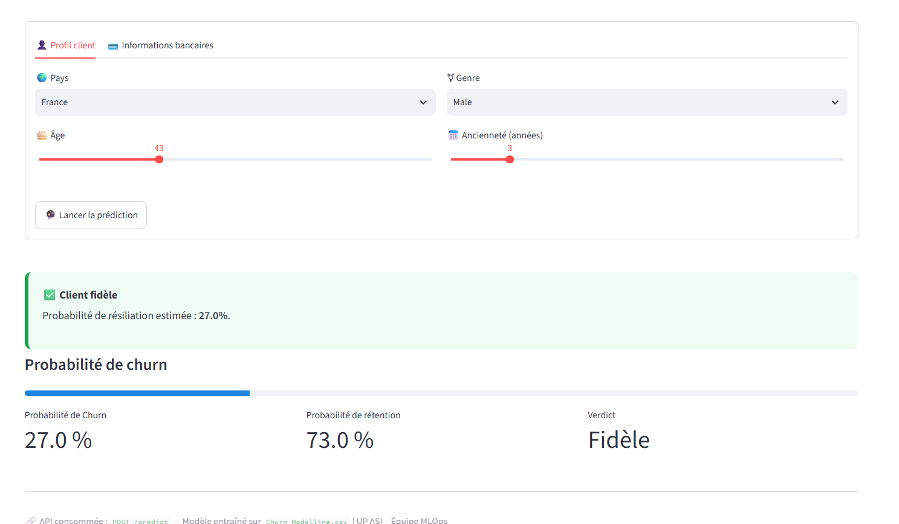

# 🏦 Projet MLOps — Prédiction du Churn Client

Ce projet met en œuvre un pipeline MLOps complet : préparation des données, entraînement d'un modèle de Machine Learning, exposition via une API REST (FastAPI), orchestration avec Prefect, et un frontend interactif (Streamlit) pour tester les prédictions.

## 📂 Structure du projet

Tous les fichiers sont au même niveau, à la racine du projet :
DevOps-Test/
├── Churn_Modelling.csv # Jeu de données (clients bancaires)
├── data_processing.py # Préparation et prétraitement des données
├── model.py # Entraînement, évaluation, sauvegarde/chargement du modèle
├── model_pipeline.py # Point d’entrée regroupant les fonctions du pipeline ML
├── main.py # Script CLI pour exécuter le pipeline (prepare/train/evaluate/save/load)
├── pipeline_prefect.py # Orchestration des flows Prefect (train, evaluate, api, frontend...)
├── deploiement_prefect.py # Déploiements planifiés (cron) des flows Prefect
├── app.py # API REST FastAPI exposant /predict
├── streamlit_app.py # Frontend Streamlit (formulaire + consommation de l’API)
├── requirements.txt # Dépendances Python
├── modele_churn.pkl # Modèle entraîné (généré après entraînement)
├── scaler.pkl # Scaler (StandardScaler) sauvegardé
├── colonnes.pkl # Liste des colonnes attendues par le modèle
├── image.png # Capture d’écran de l’interface Streamlit
└── README.md

## 🎯 Objectif

Prédire si un client va résilier son compte bancaire (**churn**) à partir de ses caractéristiques (score de crédit, pays, âge, solde, etc.), avec un modèle **RandomForestClassifier** entraîné sur `Churn_Modelling.csv`.

## 🧩 Architecture
┌────────────────────┐ formulaire ┌──────────────────────┐
│ Streamlit UI │ ────────────────────▶ │ FastAPI /predict │
│ (port 8501) │ ◀──────────────────── │ (port 8000) │
└────────────────────┘ JSON (résultat) └──────────────────────┘
│
▼
modele_churn.pkl + scaler.pkl
+ colonnes.pkl
▲
│
┌──────────────────────┐
│ Prefect (orchestr.) │
│ pipeline_prefect.py │
└──────────────────────┘

## ⚙️ Installation

```bash
# Cloner le dépôt
git clone https://github.com/ahmed200346/DevOps-Test
cd DevOps-Test

# Créer et activer l'environnement virtuel
python -m venv venv
source venv/bin/activate     # Linux / WSL

# Installer les dépendances
pip install -r requirements.txt
```

**Contenu minimal de `requirements.txt`** :
fastapi
uvicorn
streamlit
requests
pandas
scikit-learn
joblib
prefect

## 🚀 Utilisation

### 1) Entraîner le modèle

```bash
python main.py --all
```

Génère `modele_churn.pkl`, `scaler.pkl` et `colonnes.pkl`.

### 2) Démarrer le serveur Prefect (orchestrateur)

```bash
prefect server start
```

Dans un autre terminal :
```bash
prefect config set PREFECT_API_URL="http://127.0.0.1:4200/api"
```

### 3) Lancer l'API + le frontend via Prefect

```bash
python pipeline_prefect.py --flow full-app
```

Ou séparément :
```bash
python pipeline_prefect.py --flow api         # API seule
python pipeline_prefect.py --flow frontend     # Streamlit seul
```

### 4) Accéder aux interfaces

| Service | URL |
|---|---|
| API — documentation interactive (Swagger) | http://127.0.0.1:8000/docs |
| Frontend Streamlit | http://127.0.0.1:8501 |
| Dashboard Prefect | http://127.0.0.1:4200 |

## 🖥️ Aperçu de l'interface Streamlit

L'interface permet de renseigner le profil d'un client via un formulaire à onglets (*Profil client* / *Informations bancaires*), puis d'obtenir instantanément la prédiction de churn, la probabilité associée et un indicateur visuel.



Exemple de résultat : un client de 43 ans, France, Male, avec 3 ans d'ancienneté → **27% de probabilité de churn**, classé **Fidèle**.

## 🔌 Endpoints de l'API

### `GET /`
Vérifie que l'API est en ligne.

### `POST /predict`

**Corps de la requête (JSON)** :
```json
{
  "CreditScore": 600,
  "Geography": "France",
  "Gender": "Male",
  "Age": 40,
  "Tenure": 3,
  "Balance": 60000.0,
  "NumOfProducts": 2,
  "HasCrCard": 1,
  "IsActiveMember": 1,
  "EstimatedSalary": 50000.0
}
```

**Réponse** :
```json
{
  "prediction": 0,
  "churn": false,
  "probabilite_churn": 0.27
}
```

## 🔄 Flows Prefect disponibles

| Flow | Description |
|---|---|
| `train` | Prépare les données, entraîne et sauvegarde le modèle |
| `evaluate` | Charge le modèle et affiche les métriques d'évaluation |
| `code` | Formatage (black), lint (pylint), sécurité (bandit), tests unitaires |
| `all` | Pipeline complet : dépendances → code → entraînement → évaluation |
| `api` | Démarre l'API FastAPI |
| `frontend` | Démarre le frontend Streamlit |
| `full-app` | Démarre l'API **et** le frontend ensemble |

Commande générique :
```bash
python pipeline_prefect.py --flow <nom_du_flow>
```

## 🛑 Arrêter les services

```bash
kill $(lsof -t -i:8000)   # Arrête l'API
kill $(lsof -t -i:8501)   # Arrête Streamlit
```

## 👥 Équipe

Projet réalisé dans le cadre des ateliers **MLOps — UP ASI**.

## 📌 Perspectives

- Exposer la fonction `retrain()` via un endpoint `POST /retrain` pour réentraîner le modèle avec de nouveaux hyperparamètres.
- Ajouter un historique des prédictions (CSV ou base de données).
- Déploiement via Docker / CI-CD.